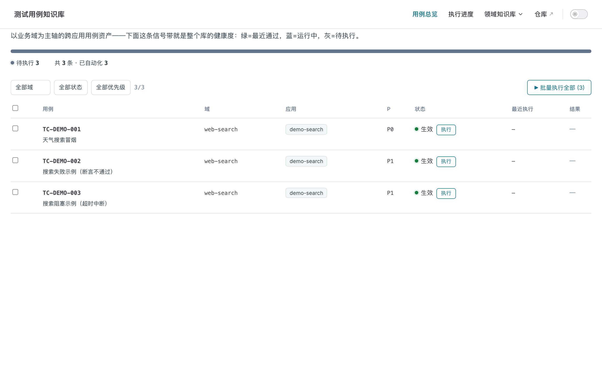
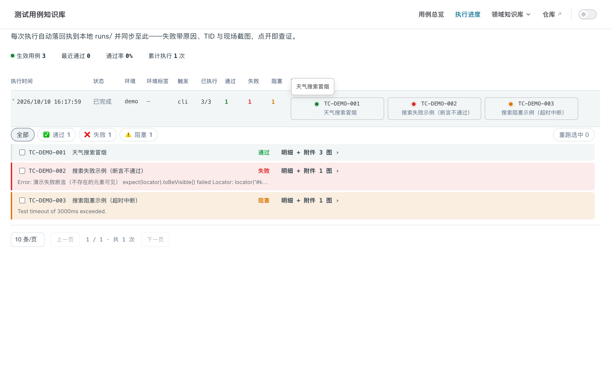
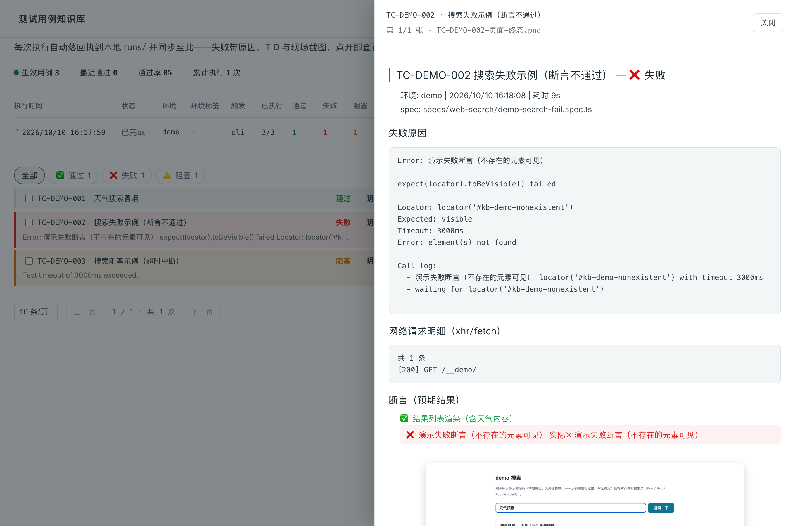

# testcase-kb — 本地测试用例知识库（Claude Code 插件）

[English](./README.en.md) | 中文

**是什么**：一个装进 Claude Code 的测试用例知识库。你对 Claude 说一句话，它写出可执行的 e2e 用例；引擎执行后，浏览器里看进度、截图、断言三态——数据全部留在你本机。

**解决什么**：写一条能跑的 Playwright 用例，对不熟工程的人门槛极高（选择器、等待、断言、登录态、环境配置）。本插件把这套专业活交给 Claude（探针实证锚点，不瞎写选择器），把「看结果」做成给测试同学看的可视化页面。

**带来什么**：
- 测试设计者：说一句话出一条可执行用例，断言 checklist 与执行结果自动对齐（✅ 通过 / ❌ 失败 / ⚠️ 阻塞）
- 测试执行：一键整域跑、失败筛出批量重跑、flaky 归因记档
- 测试同学：开一个局域网链接就看到进度、失败原因、现场截图——零安装
- 团队资产：数据默认纯本地私有；要共用领域知识库和测试用例库，把数据目录（domains/ apps/ specs/ knowledge/）推到托管代码仓库即可——全是 markdown，clone 即得整库

```
Claude（本插件）                 本地数据目录 ~/.testcase-kb（纯私有）
/kb-case  写用例 ──────────────▶  domains/  用例 md（设计单源）
/kb-run   执行    ──引擎执行──▶  specs/    Playwright 脚本
/kb-view  看进度  ◀──站点链接──  runs/     回执（截图/断言三态/网络明细）
                                 apps/     应用画像 / knowledge/ 领域知识
```

> 内置本地 demo 三态示例（通过 ✅ / 失败 ❌ / 阻塞 ⚠️）——打插件自带的 demo 站（离线可用、结果稳定）。

## 站点一览

**用例概览** —— 断言 checklist 与最近执行自动对齐：



**执行进度** —— 三态汇总、已执行/总数，点行展开明细：


**展开明细** —— 结果筛选（可多选失败+阻塞）、断言勾选、失败原因与现场截图：



**用例明细抽屉** —— 点「明细 + 附件」看断言逐条勾选与失败/阻塞原因（实际观察值 ✓/✗）：



- **写用例不写代码****：描述意图，Claude 按「断言双源同构」规范生成 md + spec.ts，选择器全部探针实证
- **执行零 AI 依赖**：纯 Playwright 脚本，CI 可裸跑；判定只看 spec 断言
- **可视化即分享**：本地站点（总览/进度/筛选重跑/断言 checklist 三态），测试同学浏览器开局域网链接即看，零安装
- **纯本地，可共享**：数据默认私有（`~/.testcase-kb`，不进任何 git）；团队要公用领域知识库与测试用例库时，把数据目录推托管代码仓库，成员 clone 后设 `KB_ROOT=<仓库路径>` 即用同一套用例/画像/知识

## 安装

```bash
# ① 注册 marketplace（本地路径亦可：claude plugin marketplace add /path/to/testcase-kb）
claude plugin marketplace add https://github.com/Niko-Wu/testcase-kb.git
# ② 安装插件
claude plugin install testcase-kb@testcase-kb
```

然后对 Claude 说 `/kb-init`——首次运行自动安装插件依赖与 Chromium（约 1-2 分钟），并把示例域播种到 `~/.testcase-kb`。

## 命令

| 命令 | 作用 |
|---|---|
| `/kb-init` | 初始化数据目录（示例域 + 依赖软链 + 站点入口页） |
| `/kb-case` | 写/改用例（对话式，生成双源文件，锚点实证） |
| `/kb-run` | 执行（单条/整域/冒烟），实时汇报三态 |
| `/kb-view` | 起站点给链接（`http://localhost:4570`，局域网可分享） |
| `/kb-analyze` | 失败归因（回执证据链 → 结论 + 下一步） |

CLI 等价（`KB_ROOT` 默认 `~/.testcase-kb`）：

```bash
pnpm kb:init                 # 播种/修复数据目录
pnpm kb:server               # 站点（--port 4570；kb-run 打本机环境会自动拉起，一般不用手动跑）
pnpm run:case TC-DEMO-001   # 单条（demo 环境挂在本机 server，端口取自画像 envs，kb-run 自动确保在线）
pnpm run:domain web-search   # 整域
pnpm auth import <host>      # 私有站点导登录态（从你的浏览器）
pnpm record <url>            # Playwright codegen 录制
```

## 三步上手（示例：给搜索域加用例）

```bash
# ① 已有域直接写；新域先 /kb-init 建画像（apps/<应用>.md 维护环境链接）
# ② 对 Claude 说：/kb-case web-search 搜索新闻词出结果列表
#    → 生成 domains/web-search/TC-*.md + specs/web-search/*.spec.ts
# ③ 对 Claude 说：/kb-run web-search
#    → 三态汇报；/kb-view 打开站点看进度与截图
```

内置示例域 `web-search`：打插件自带 demo 站（`/__demo/`，kb-server 托管、离线可用）。`TC-DEMO-001` 通过、`TC-DEMO-002` 故意失败（前序断言仍 ✅、失败项 ❌）、`TC-DEMO-003` 故意超时阻塞（checklist 全 ⚠️）——一次跑齐三态。demo 结构对齐真实搜索页（`#kw/#su/#content_left`），接你自己的站点只需改画像 envs 一行。

## 数据目录结构（`~/.testcase-kb`）

```
├── domains/<域>/TC-*.md    用例（frontmatter + 步骤 + 断言 checklist）
├── specs/<域>/*.spec.ts    Playwright 脚本（common/fixture 公共能力）
├── apps/<应用>.md          应用画像：envs 环境链接 / exec.headers / locale / auth: none / 坑
├── knowledge/<域>.md       领域知识：测试范围 / 特殊配置 / 实证坑（站点导航自动收录）
└── runs/<时间戳>/          执行回执：run.yaml + 每用例 结果.md/截图/断言明细
```

引擎与站点代码全在插件仓（升级不动你的数据）。

**本地模式与共享模式**：默认纯本地（`~/.testcase-kb`，不进任何 git）。团队要公用领域知识库与测试用例库时，把数据目录推到托管代码仓库（GitLab/GitHub），成员 clone 后设 `KB_ROOT=<仓库路径>`（或在其内运行）即得同一套 domains/ apps/ specs/ knowledge/；执行回执（runs/）与登录态（.auth/）按预置 `.gitignore` 留在各人本地，互不干扰。

## 判定口径

- **只看 spec 断言**：全部通过 = ✅；任一失败 = ❌（失败前的断言仍标 ✅，其后未执行项标 ⚠️）；超时/中断 = ⚠️ 阻塞
- **预期 vs 实际一一对应**：断言描述 = 用例 md checklist 文本（回执三态勾选靠它对齐）；有真实观察值挂「实际✓/✗」行
- **5xx 是警告不是失败**：环境噪音在执行配置里给豁免正则，判定不变

## 应用画像怎么写（`apps/*.md`）

```yaml
---
name: my-app
kind: frontend
envs:                 # 环境链接（常用放首位 = 默认）
  daily: https://my.daily.example.com
  prod: https://my.example.com
exec:
  headers:            # 网关路由头（按需）
    x-micro-app-name: my-app
  locale: zh-CN       # 被测应用语言（无头默认 en-US 会渲染英文）
auth: none            # 公开站点免登录探针（私有站点删掉此行）
---
```

正文写：e2e 环境策略 / 账号方式 / 已知坑——只写测试执行所需，项目历史知识用你自己的 Obsidian 沉淀。

## 开发本插件

```bash
pnpm build          # 站点产物 site-dist/（server 首启也会自动构建）
pnpm kb:server      # 起服务（静态 + /__kb/* API + runs 实时聚合）
```

改主题/页面后重跑 `pnpm build`（server 只 serve 产物）；引擎脚本（scripts/*.mjs）改动即时生效。

## License

MIT
